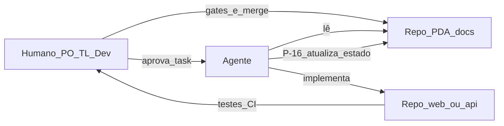

# Como funciona o framework PDA (PDA-Squad)

Guia prático do **Processo de Desenvolvimento Assistido por Agentes para Squads**.  
Este documento explica o *porquê*, o *fluxo* e o *como usar* no dia a dia — com o exemplo real do **Reserva Corporativa (RESREC)** neste workspace.

---

## 1. O que é o PDA

O PDA-Squad é um **processo** (não uma biblioteca de código) para usar agentes de IA (Cursor, Claude Code, Codex, etc.) em squads **sem perder**:

- rastreabilidade das decisões;
- qualidade e testes;
- controle humano (merge / arquitetura / segurança);
- continuidade entre sessões de chat.

**Premissa:** agentes aceleram implementação, mas só de forma previsível com **contexto versionado**, **escopo claro**, **tarefas pequenas**, **testes** e **limites de autonomia**.

O PDA **não** substitui PO, Tech Lead, QA nem arquitetura. A IA é **acelerador controlado**, não decisor invisível.

---

## 2. Peças do workspace (multi-repositório)

No PDA2 (como em qualquer projeto PDA):

```text
PDA2/                              # pasta agregadora (NÃO é o repo do agente)
├── .pda-workspace.yaml            # mapa: papéis → pastas
├── recursos-corporativos-tati-pda # repositório PDA (docs canônicos)
├── recursos-corporativos-tati-web # frontend
├── recursos-corporativos-tati-api # backend
├── pda-squad/                     # processo + skills + CLI (kit)
└── PDA/                           # este GitHub (backup documental + guias)
```

Arquivo [`.pda-workspace.yaml`](../../.pda-workspace.yaml) (na pasta agregadora):

| Papel | Pasta |
| --- | --- |
| `pda` | `recursos-corporativos-tati-pda` |
| `web` | `recursos-corporativos-tati-web` |
| `api` | `recursos-corporativos-tati-api` |

**Regras de ouro multi-repo:**

| Permitido | Proibido |
| --- | --- |
| Ler o PDA de outro repo | Escrever no PDA durante implementação (exceto `PROJECT_STATE` via P-16) |
| Uma task = um repositório-alvo | Um agente alterar web **e** api na mesma execução |
| Executar o agente **dentro** do repo-alvo | Tratar a pasta `workspace` como repositório operacional |

---

## 3. Cadeia de artefatos (produto → código)

```text
Demanda / visão
    ↓
PRD.md                          (produto)
    ↓ Gate humano de produto
TECHNICAL_PLAN.md               (arquitetura / segurança / identidade)
    ↓ Gate arquitetura / segurança
DEVELOPMENT_PLAN.md             (incrementos e features)
QUALITY_PLAN.md
    ↓
Incremento 0 (fundações)
    ↓
Para cada FEAT-nnn:
    FEATURE_SPEC.md
    IMPLEMENTATION_PLAN.md      (só se risco/complexidade exigir)
    TASK_BREAKDOWN.md
        ↓
    Para cada TASK:
        P-15 implementar no repo-alvo
        testes / lint / build
        P-16 revisar → atualiza PROJECT_STATE.md
        revisão humana → merge
```

### Onde vive cada coisa (paths canônicos)

| Artefato | Local |
| --- | --- |
| PRD | `docs/product/PRD.md` |
| Plano Técnico | `docs/architecture/TECHNICAL_PLAN.md` |
| ADRs | `docs/architecture/adr/` |
| Development / Quality | `docs/planning/`, `docs/testing/` |
| Estado | `docs/implementation/PROJECT_STATE.md` |
| Feature | `docs/features/FEAT-xxx/FEATURE_SPEC.md` (+ IMPLEMENTATION_PLAN, TASK_BREAKDOWN) |
| Prompts | `docs/prompts/` (P-01…P-19) |
| AGENTS.md | raiz de cada repo (regras permanentes para o agente) |

---

## 4. Trilhas de complexidade (documentação proporcional)

Nem tudo precisa da trilha completa.

| Trilha | Quando | Artefatos típicos |
| --- | --- | --- |
| **Leve** | bug pequeno, docs, lint | AGENTS + TASK + (QUALITY) |
| **Média** | feature simples | PRD + TECHNICAL + DEVELOPMENT + FEATURE_SPEC + TASK + PROJECT_STATE |
| **Completa** | segurança, dados, multi-repo, DS | + IMPLEMENTATION_PLAN + revisão agente + ADR se preciso |

---

## 5. Ciclos operacionais (prompts / skills)

A ordem **não** é P-01 → P-19 em linha reta. São **ciclos**:

```text
Ciclo 1 — Fundação          P-01 PRD … P-09 AGENTS / bootstrap
Ciclo 2 — Incremento 0      P-10 tasks INC-0 → P-15/P-16 por task
Ciclo 3 — Loop por feature  P-12 Spec → (P-13) → P-14 Breakdown
Ciclo 4 — Loop por tarefa   P-15 implementar → P-16 revisar
Ciclo 5 — Estado            PROJECT_STATE atualizado (P-16)
```

### Skills do kit (`pda-squad-skills`)

| Skill | Função |
| --- | --- |
| `pda-feature-decomposition` | P-12 → gate → P-13 se necessário → P-14 |
| `pda-task-execution` | Executa **uma** task; PDA só leitura |
| `pda-task-review` | Revisão independente; pode atualizar `PROJECT_STATE` (P-16) |

Na CLI / fluxo completo também aparecem skills como `pda-init`, `pda-prd`, `pda-architecture`, `pda-roadmap`, `pda-run`, `pda-validate`, `pda-prepare` (ver README do `pda-cli`).

### Regra essencial de implementação

> O agente **não** começa pelo PRD ou pelo plano técnico.  
> Começa pela **tarefa**, pelo **`AGENTS.md`**, pelo **repositório-alvo** e pelo **código real**.

---

## 6. Gates e revisão humana

Em cada etapa fundacional (PRD, arquitetura, roadmap):

1. Agente **produz** o artefato (prompt P-xx).
2. Outro passo / humano **revisa** (P-02, P-04, etc.).
3. **Gate:** aprovado / aprovado com ressalvas / bloqueado (volta à etapa).
4. Só então avança.

Na implementação:

1. `pda-run TASK-…` → código no repo-alvo.
2. Validação automatizada (testes, build).
3. `pda-validate` / P-16.
4. **Humano** decide merge.

---

## 7. Exemplo real neste workspace: Reserva Corporativa

| Camada PDA | Exemplo RESREC |
| --- | --- |
| Produto | PRD + PRD_REVIEW |
| Arquitetura | TECHNICAL_PLAN, ADR-003 (intervalo), ADR-004 (auth blueprint) |
| Provisionamento | PROVISIONING.md (RESREC, client SSO), CATALOGO actionIds |
| Planejamento | DEVELOPMENT_PLAN → FEAT-000…003 |
| Features | `docs/features/FEAT-001` (catálogo), `FEAT-002` (reserva), `FEAT-003` (admin D09) |
| Estado | PROJECT_STATE.md (tasks, evidências, próximos passos) |
| Runtime local | [ROTEIRO_LOCAL_CASA.md](../implementation/ROTEIRO_LOCAL_CASA.md) |

Fluxo que a squad seguiu na prática:

```text
FEAT-000 (fundações + identidade RESREC)
   → FEAT-001 (categorias/recursos)
   → FEAT-002 (reserva usuário + conflito)
   → FEAT-003 (admin reservas D09)
```

Cada feature: Spec → (Implementation Plan) → Task Breakdown → tasks em **api** ou **web** → testes → P-16 → merge.

---

## 8. Diagrama mental (humano × agente)



---

## 9. Checklist rápido: “vou rodar um agente agora”

1. Existe **TASK** no `TASK_BREAKDOWN` com repo-alvo e aceite?
2. Estou no diretório do **repo-alvo** (não na pasta agregadora)?
3. Li o **`AGENTS.md`** daquele repo?
4. Não vou inventar auth/login local se o TECHNICAL_PLAN/PROV proíbe?
5. Diff limitado a esta task?
6. Testes / build rodaram?
7. `PROJECT_STATE` / revisão humana antes do merge?

---

## 10. O que o PDA não é

- Não é Scrum/Kanban (pode conviver com eles).
- Não garante qualidade automática.
- Não autoriza o agente a decidir arquitetura ou segurança sozinho.
- Não mede produtividade por linhas de código geradas.

---

## 11. Onde aprofundar

| Fonte | Conteúdo |
| --- | --- |
| Pasta `pda-squad/` neste workspace | Processo completo, CLI, skills |
| `pda-squad/README.md` | Visão e princípios |
| `pda-squad/proposta_pda_squad.md` | Documento longo do processo |
| `pda-squad/prompt_sequence.md` | Ordem dos prompts |
| `pda-squad/pda-cli/README.md` | Skills `pda-init` … `pda-run` |
| `pda-squad/pda-squad-skills/README.md` | Kit P-12/P-15/P-16 + workspace yaml |
| Este repo `PDA` | Backup documental RESREC + este guia |

---

## 12. Resumo em uma frase

**PDA = documentação canônica no repo `-pda` + tarefas pequenas com agente no repo certo + testes + revisão humana**, orquestrado por prompts/skills e pelo `.pda-workspace.yaml`.
